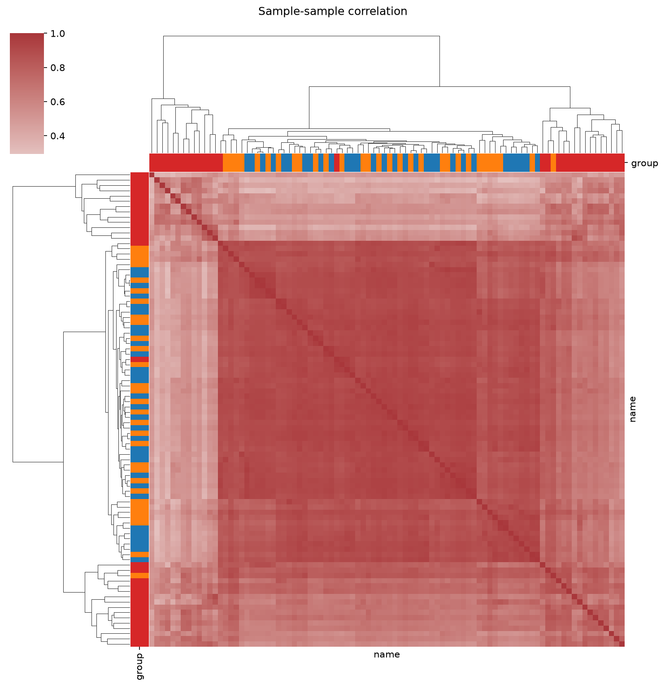
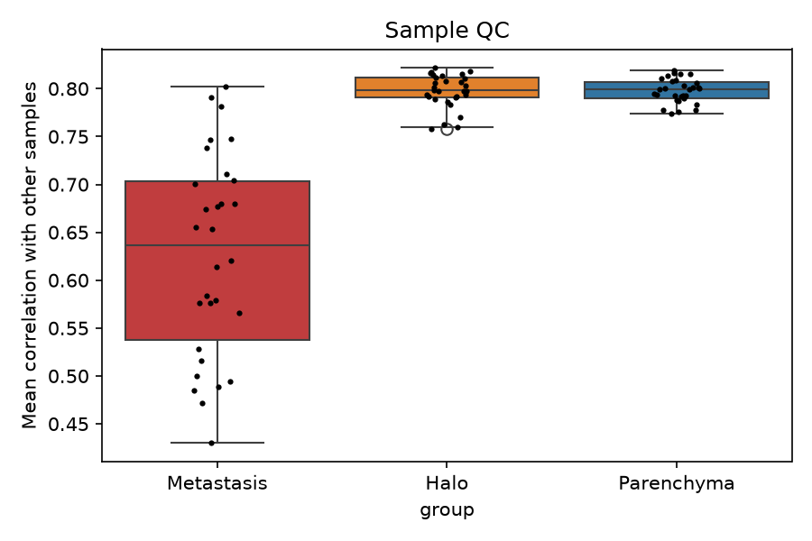
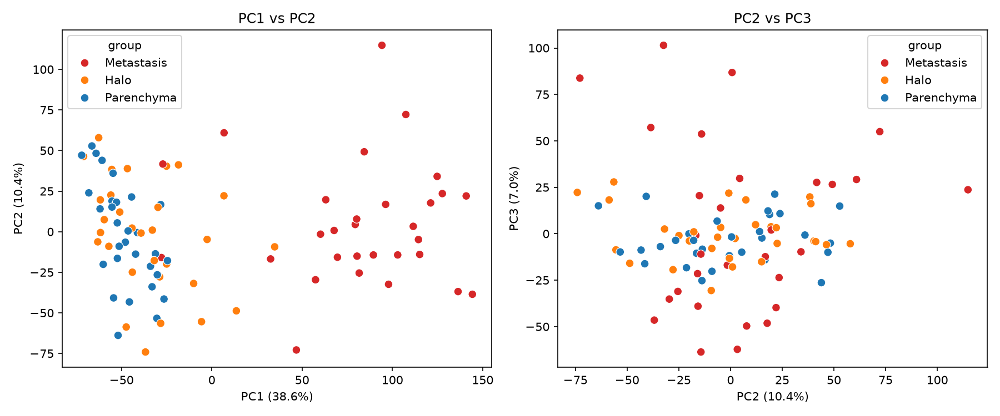
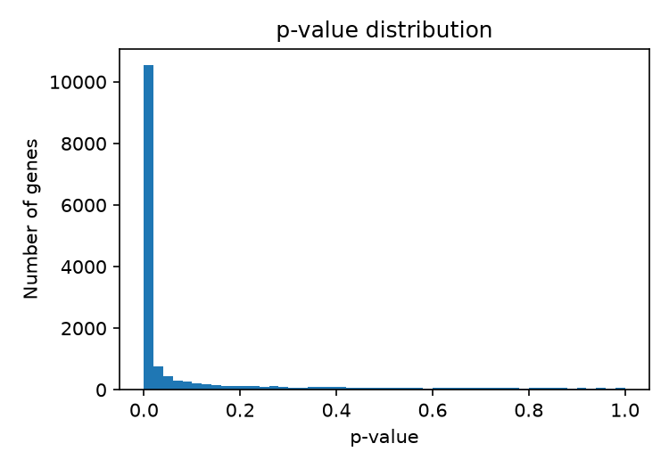
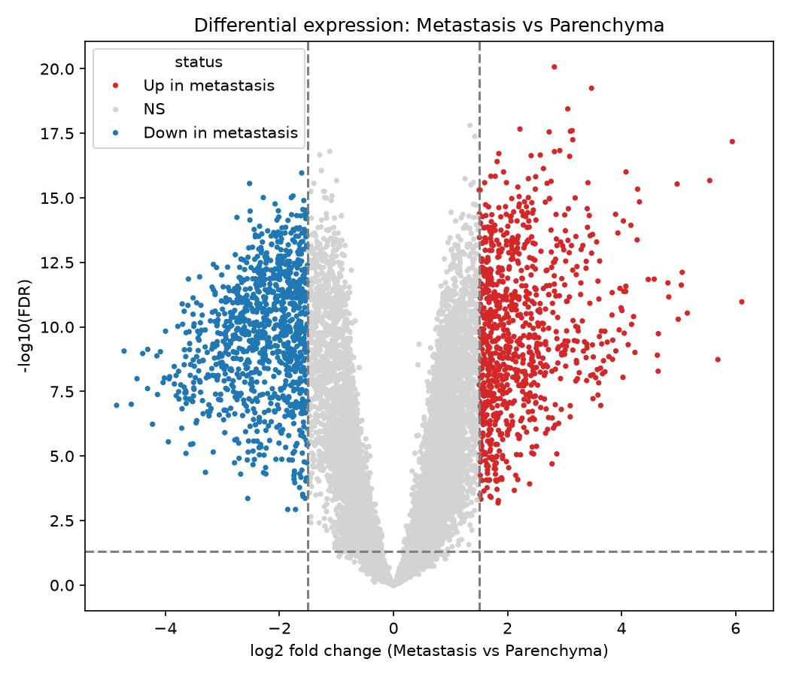
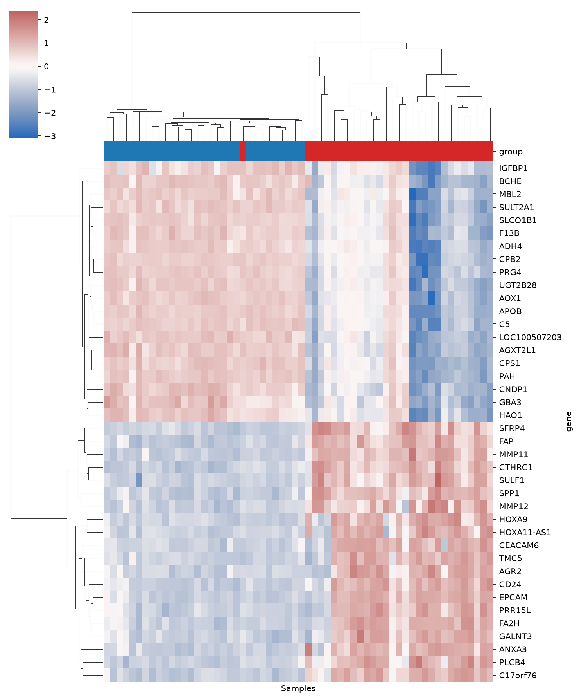

# Differential Gene Expression in Colorectal Liver Metastases (GSE38174)

A complete microarray differential-expression workflow in Python: data retrieval from GEO, probe-to-gene mapping, sample QC, PCA, Welch's t-test with Benjamini–Hochberg FDR, biological sanity checks, sensitivity analyses and pathway enrichment.

Full analysis with code and outputs: [`notebooks/analysis.ipynb`](notebooks/analysis.ipynb)

**Question:** Which genes differ between colorectal-cancer liver metastases and the surrounding normal liver tissue, and what biology do those genes reflect?

## Key results

- **15,885 genes** tested (30 metastasis vs 30 matched liver parenchyma biopsies).
- **1,960 differentially expressed genes** (FDR < 0.05 and |log2FC| > 1.5): **922 up** and **1,038 down** in metastasis.
- The result does not depend on the test: Welch, Mann–Whitney and paired t-test returned **the identical set of 1,960 genes**.
- **Biological validation:** liver-specific genes (*ALB, APOA1, APOA2, TF, CYP3A4, SERPINA1*) are down; colorectal epithelial markers (*EPCAM, CDX2, KRT20, CEACAM5, CDH17, VIL1*) are up.
- **Important caveat:** metastasis is compared with a *different tissue* (liver), so a large part of the signal reflects tissue of origin rather than cancer-specific biology (see [Limitations](#limitations)).

## Dataset

| | |
|---|---|
| Source | [GEO GSE38174](https://www.ncbi.nlm.nih.gov/geo/query/acc.cgi?acc=GSE38174) (Lordan J, Bucca G, Laing E, Smith CP; University of Surrey) |
| Platform | GPL6480, Agilent-014850 Whole Human Genome 4x44K, **two-colour** (sample vs. Stratagene Universal Human Reference) |
| Samples | 96 arrays: 30 liver metastasis, 30 "halo" (area where tumour regressed after neoadjuvant chemotherapy), 30 liver parenchyma (control), 6 normal colon |
| Used here | Statistics: 30 metastasis vs 30 parenchyma. Exploratory analysis (QC/PCA): + 30 halo. Normal colon samples were not used. |
| Values | log2 ratios (sample / reference), processed by the submitters with Agilent Feature Extraction and GeneSpring. Values range from −10.2 to 12.2 with no missing values and all sample medians are close to 0, so no further log transform or normalisation was applied |

The sample `description` field identifies the subject (e.g. "Liver biopsy of metasis from subject 1"). An assertion in the notebook confirms that the replicate number in the sample title equals this subject number for all 90 metastasis, halo and parenchyma samples, so each metastasis biopsy has a matching parenchyma biopsy from the same patient.

## Pipeline

1. **Load** the series with `GEOparse`; build the expression matrix (41,093 probes × 96 samples) and sample metadata. Sample groups were parsed from the sample titles.
2. **Check the scale:** values range from −10.2 to 12.2 with no missing values, i.e. log2 ratios, so `log2()` was **not** applied again.
3. **Probe → gene:** annotation from GPL6480 (`GENE_SYMBOL`). Control probes, probes without a symbol and probes mapping to several genes (`///`) were removed (41,093 → 30,936 probes, 19,595 unique genes).
4. **Low-variance filter:** probes in the lowest quartile of overall variance were dropped. The filter does not use group labels.
5. **Collapse to one row per gene** by averaging probes. This is justified by the data: for *RPL21* (14 probes) the mean pairwise probe correlation is 0.91 (minimum 0.79). Final matrix: **15,885 genes × 60 samples** (15,897 × 90 with halo).
6. **QC and PCA** (below).
7. **Differential expression:** log2FC = mean(metastasis) − mean(parenchyma) (valid because both groups are expressed relative to the same reference); Welch's t-test per gene; Benjamini–Hochberg FDR.
8. **Validation, sensitivity analyses and enrichment.**

## Sample QC




| Group | Mean within-group correlation | Range (per sample) |
|---|---|---|
| Parenchyma | 0.90 | 0.87 – 0.92 |
| Halo | 0.88 | 0.83 – 0.91 |
| Metastasis | **0.65** | 0.47 – 0.73 |

Parenchyma and halo samples are very homogeneous. Metastases are far more heterogeneous, and a few cluster together with the liver samples. This is interpreted as **biological heterogeneity (probably differences in tumour content), not as technical failure**, so no sample was removed.

## PCA



- PC1 separates metastasis from liver tissue (38.6 % of variance without gene scaling; 29.0 % with scaling). PCA was run **with and without** per-gene standardisation and the structure was the same.
- Halo samples overlap with parenchyma, i.e. after chemotherapy the halo resembles liver tissue; only a few lean toward the metastases.
- A few metastases sit inside the liver cluster, consistent with low tumour content (hypothesis, not tested directly).

Scaled version and replicate labels: [`pca_scaled.png`](figures/pca_scaled.png), [`pca_replicate_labels.png`](figures/pca_replicate_labels.png). Samples with the same replicate number do not sit close together on PC1/PC2: tissue type dominates over subject.

## Differential expression




The raw p-value histogram has a strong peak near 0 and a flat tail, as expected when there is real signal. Because two different tissues are compared, the signal is extremely broad: 11,167 genes have FDR < 0.05 on their own (Welch), so an effect-size filter (|log2FC| > 1.5) was added to keep the list interpretable.

### Top 40 genes



The 20 most up- and 20 most down-regulated significant genes (ranked by log2FC), row-wise z-scored. Note that these genes were selected for differing between the groups, so the clean separation of columns here is expected and is **not** an independent validation; the label-free PCA above is the unbiased check.

## Biological validation

| Expectation | Genes | Result |
|---|---|---|
| Liver-specific genes should be lower in metastasis | *TF, CYP3A4, APOA2, SERPINA1, APOA1, ALB* | all down (log2FC −1.8 to −3.8, FDR ≤ 3.2e-6) |
| | *CYP2E1* | log2FC −1.48, FDR 2.7e-4: just misses the threshold (NS) |
| Colorectal epithelial genes should be higher | *EPCAM* (+6.1), *KRT20* (+3.7), *CEACAM5* (+3.5), *CDH17* (+3.5), *CDX2* (+3.0), *VIL1* (+1.7) | all up |
| | *LGR5* | log2FC +0.68, FDR 0.018: significant but small effect (NS) |

*CYP2E1* and *LGR5* show how the arbitrary effect-size threshold shapes the final list.

## Pathway enrichment

Up- and down-regulated genes were analysed **separately** with Enrichr (via `gseapy`; GO Biological Process 2023 and KEGG 2021 Human), using all 15,885 tested genes as the **background** (not the whole genome) and excluding `LOC*` identifiers.

| Direction | Top terms (adjusted p-value) |
|---|---|
| **Down** in metastasis | Complement and coagulation cascades (5e-35), Steroid metabolic process (6e-24), Fatty acid metabolic process (2e-23), Drug metabolism (3e-23), Retinol metabolism (3e-22), Metabolism of xenobiotics by cytochrome P450 (3e-22) |
| **Up** in metastasis | Extracellular matrix organization (1e-12), Protein digestion and absorption (1e-6), Collagen fibril organization (1e-6), Regulation of cell migration (3e-6), Mitotic spindle organization (3e-6), Mitotic sister chromatid segregation (4e-6) |

Down-regulated terms are classic hepatocyte functions, which confirms that this side mostly reflects the liver background. Up-regulated terms point to **extracellular matrix/stroma and cell migration** (consistent with *MMP11, MMP12, FAP, SFRP4* in the heatmap) and **cell division**. Terms share genes (for example collagens), so they represent a few themes, not independent findings.

## Robustness checks

| Check | Outcome |
|---|---|
| Welch vs Mann–Whitney vs paired t-test | Same 1,960 genes (FDR < 0.05 only: 11,167 / 11,392 / 12,132 genes). Spearman correlation of raw p-values, Welch vs Mann–Whitney: 0.98 |
| PCA with vs without gene scaling | Same structure |
| Remove GSM936290 (metastasis that clusters with liver) | All 1,960 genes retained; 121 additional genes pass the threshold (2,081) |

## Limitations

- **Tissue confounding.** Metastases (colon-derived tumour in liver) are compared with normal liver. Genes that are down largely reflect missing hepatocytes; genes that are up combine tumour, colon-lineage and stromal signal. The results describe differences in this comparison and do not identify genes that cause cancer.
- **Tumour purity** probably varies between metastases (within-group correlation 0.65). This was inferred from QC/PCA and the liver-gene pattern and was not modelled or tested.
- **Thresholds are arbitrary** (FDR < 0.05, |log2FC| > 1.5); see *CYP2E1* and *LGR5*.
- **Two-colour reference design:** log2FC values are differences between ratios to a common reference, not absolute expression.
- **Probe handling:** multi-gene probes were dropped and multiple probes per gene were averaged.
- **Single dataset**, no independent validation cohort, and treatment/clinical covariates were not modelled.
- Enrichr is a web service whose gene-set libraries are updated, so enrichment output can change slightly over time.
- The halo group is only used descriptively (QC/PCA), not statistically.

## Reproduce

```bash
git clone https://github.com/KamalAlaviA/crc-liver-metastasis-expression.git
cd crc-liver-metastasis-expression
python -m venv .venv && source .venv/bin/activate
pip install -r requirements.txt
jupyter lab notebooks/analysis.ipynb
```

Run all cells. `GEOparse` downloads GSE38174 into `data/` automatically (large file, not tracked in git). The enrichment step needs an internet connection.

Developed with Python 3.14, pandas 3.1.0, numpy 2.4.2, scipy 1.18.1, matplotlib 3.11.1 and gseapy 1.3.2.

## Repository structure

```
├── notebooks/analysis.ipynb   # full analysis with outputs
├── figures/                   # all figures used above
├── results/                   # de_results.csv, enrichment tables
├── data/                      # GEO download (git-ignored)
├── requirements.txt
└── README.md
```

## Tools

Python, pandas, NumPy, SciPy, statsmodels, scikit-learn, seaborn, matplotlib, GEOparse, gseapy, Jupyter.

---
Author: [@KamalAlaviA](https://github.com/KamalAlaviA)
